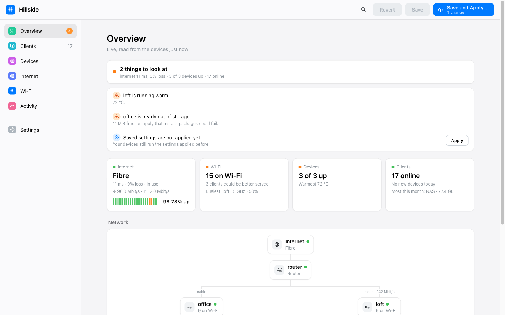
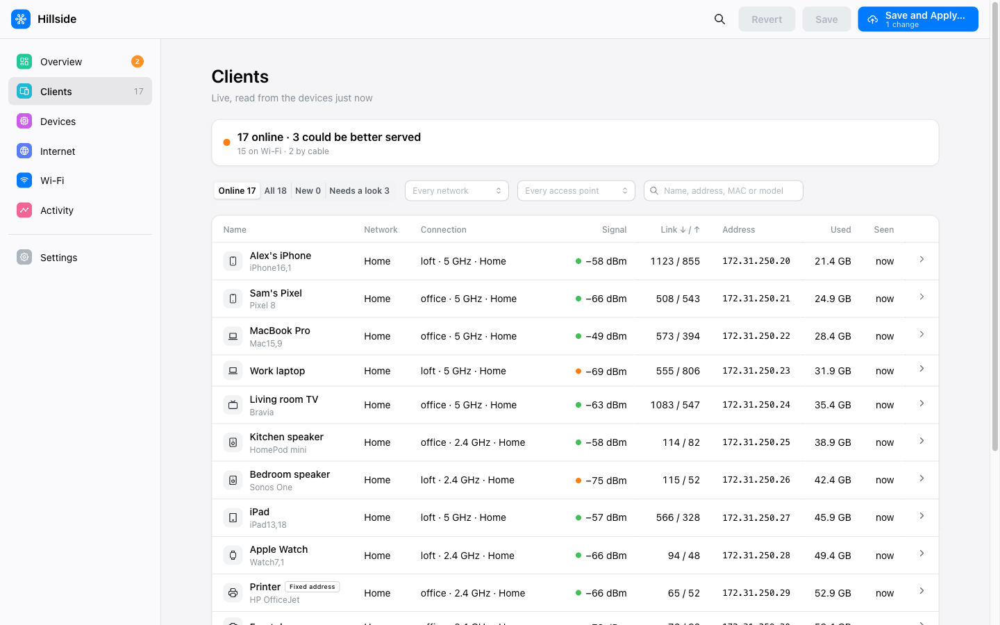
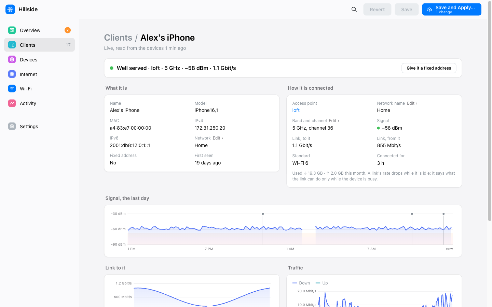
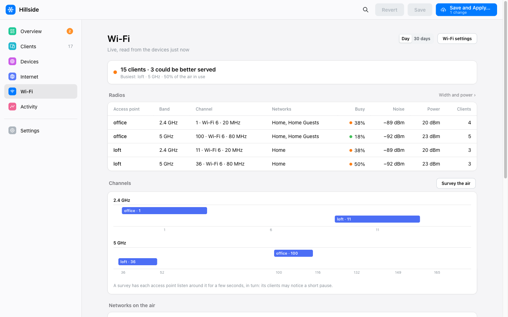
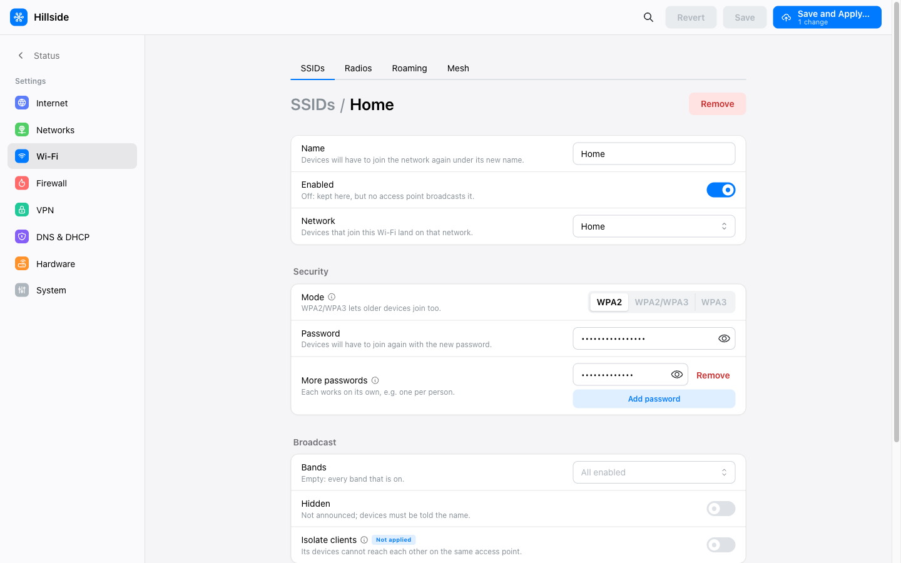
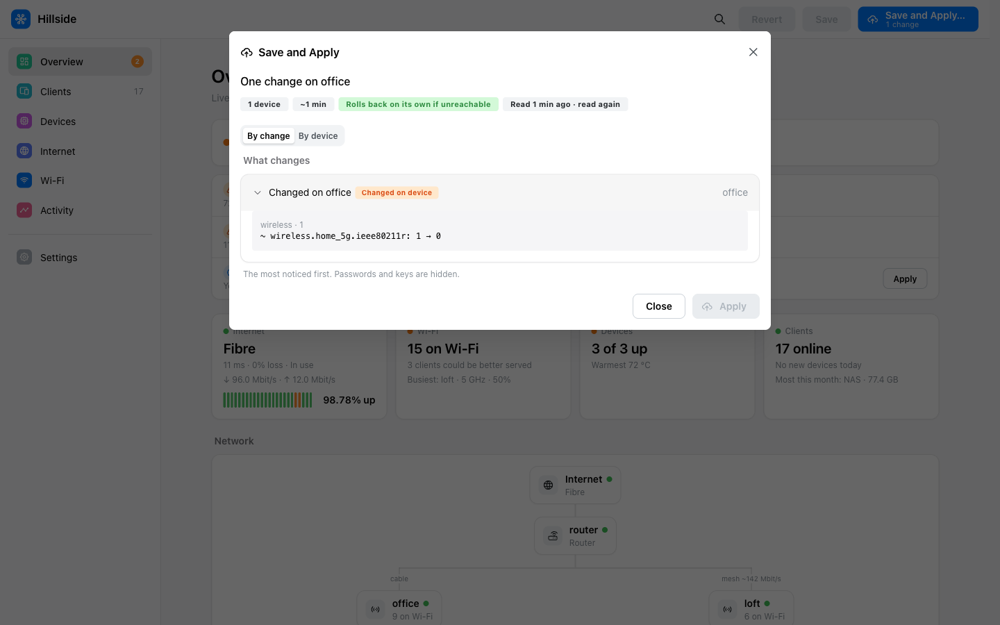

# OpenWrt Configurator

**Describe your network. The compiler handles OpenWrt.**

One file holds your whole home network: the internet lines, networks and VLANs, Wi-Fi, mesh, firewall, VPN and DNS, written as decisions rather than UCI. A web UI edits it, a compiler turns it into each router's and access point's configuration, and the app applies it to all of them over SSH, showing exactly what will change first.

> [!NOTE]
> **Early days: looking for testers and feedback.** It is tested end to end against OpenWrt in Docker and against captured board data, but has barely met real hardware yet. If you try it, please [open an issue](https://github.com/jasrusable/openwrt-configurator/issues) with what worked and what didn't. Requires **OpenWrt 25.12 or later**, and is built for **a router plus separate access points**: the router itself does not broadcast Wi-Fi (yet).

<picture>
  <source media="(prefers-color-scheme: dark)" srcset="docs/screenshots/overview-dark.png">
  
</picture>

## Why

OpenWrt can do almost anything, but you have to say how: which port is `lan3` on this board, DSA or swconfig, which `radio1` is the 5 GHz one, which option a release renamed, which package to swap for WPA3, and the same again on every access point. Configurator moves all of that into a compiler.

- **Your file holds decisions, never plumbing.** "A guest network on its own VLAN, Wi-Fi on every access point, the printer at a fixed address." You never write UCI, interface names, radio paths or switch layouts.
- **Hardware is read, not written down.** Each device's model, ports, switch type (DSA or swconfig), radios and bands are read from the device itself. Swap the router or add an access point and the file doesn't change.
- **OpenWrt changes, your file doesn't.** Every apply regenerates each device's whole configuration from your file, so no stale or old-format config lingers. Firmware upgrades re-apply your settings, compiled for the new release.
- **Known OpenWrt bugs, fixed for you.** Fixes are targeted by model and release, each shown with why, a link to the upstream issue, and when it goes away. They are dropped automatically once OpenWrt fixes the bug.
- **No drift.** Each device ends up exactly as declared, and anything not declared is removed. A setting changed by hand on a device shows up as "Changed on office" and is put back on the next apply.
- **Guard rails, not error messages.** Settings that can't work together can't be chosen. A Wi-Fi channel your country doesn't allow is greyed out, with the reason.
- **And the safety you'd expect.** A review of every line that will change before anything does, all devices changed as one, and an automatic rollback on any device the app can't reach afterwards.

## A look around

<table>
<tr>
<td width="50%">
<picture>
  <source media="(prefers-color-scheme: dark)" srcset="docs/screenshots/clients-dark.png">
  
</picture>
<p align="center"><b>Clients</b>, named from mDNS, with where each is connected and how well</p>
</td>
<td width="50%">
<picture>
  <source media="(prefers-color-scheme: dark)" srcset="docs/screenshots/client-dark.png">
  
</picture>
<p align="center"><b>A client</b>: its connection, signal and traffic over the day, and its roams</p>
</td>
</tr>
<tr>
<td width="50%">
<picture>
  <source media="(prefers-color-scheme: dark)" srcset="docs/screenshots/wifi-dark.png">
  
</picture>
<p align="center"><b>Wi-Fi</b>: every radio's channel, airtime and noise</p>
</td>
<td width="50%">
<picture>
  <source media="(prefers-color-scheme: dark)" srcset="docs/screenshots/settings-ssid-dark.png">
  
</picture>
<p align="center"><b>Settings</b> in plain terms, each saying what it does</p>
</td>
</tr>
</table>

<picture>
  <source media="(prefers-color-scheme: dark)" srcset="docs/screenshots/apply-dark.png">
  
</picture>
<p align="center"><b>Apply</b> reads every device first and shows each line that will change, most noticeable first</p>

<sub>Screenshots are of a made-up network (<code>scripts/status-preview.ts</code>).</sub>

## What it covers

| | |
|---|---|
| **Internet** | DHCP, static, PPPoE; several lines with failover (mwan3), IPv6 |
| **Networks** | VLANs, guest isolation, DHCP reservations, per-network DNS |
| **Wi-Fi** | SSIDs on every access point, WPA2/WPA3, several passwords per SSID, fast roaming and band steering, wired and wireless mesh |
| **Firewall** | Port forwards, rules between networks, UPnP |
| **VPN** | WireGuard remote access and site-to-site; a network routed through a VPN provider (WireGuard or OpenVPN) |
| **DNS** | DNS over HTTPS with a fallback, keeping devices on the router's DNS, a local domain |
| **Firmware** | Upgrades through OpenWrt's firmware builder, with your packages built in and your settings kept |
| **Status** | Clients, devices, internet quality, Wi-Fi airtime, events and history, without LuCI |

## Get started

**1. Install** it on your router (OpenWrt 25.12+, about 350 KB with its `quickjs` dependency):

```sh
wget -O /etc/apk/keys/openwrt-configurator.pem https://jasrusable.github.io/openwrt-configurator/openwrt/openwrt-configurator.pem
echo "https://jasrusable.github.io/openwrt-configurator/openwrt/packages.adb" >> /etc/apk/repositories.d/customfeeds.list
apk update && apk add openwrt-configurator
```

The UI is then at `http://<router>/cgi-bin/onc/`, behind your root password. Or run it from a Mac with `brew install jasrusable/tap/openwrt-configurator` and `openwrt-configurator ui network.json`; other options are in [Install](docs/install.md).

**2. Add your devices** under Settings › Hardware, by IP address. Each device's SSH host key fingerprint is shown for you to confirm before it is trusted.

**3. Describe your network** in Settings, then **Apply** and review what will change.

> [!WARNING]
> **The first apply replaces each device's configuration entirely.** Anything you haven't described in the app is removed. Back up your current config first (LuCI › System › Backup), and start with an access point rather than your router if you can.

## Documentation

- [Install](docs/install.md): the router package, macOS and Linux, from source
- [How it works](docs/how-it-works.md): the compiler, the apply, the fixes over OpenWrt, firmware upgrades
- [FAQ](docs/faq.md): LuCI, your existing config, supported hardware, what's missing
- [The low-level config](docs/low-level-config.md): the hand-written UCI-like JSON format and the CLI
- [TODO.md](TODO.md): open work

## Status and support

- **OpenWrt 25.12 or later** only. The app drives `apk`, and older releases are refused before anything changes.
- **A router plus access points.** Wi-Fi is configured on access points only; an all-in-one router's radios are left off. Every LAN port carries every network (no per-port networks yet).
- **Tested** end to end against OpenWrt in Docker (`scripts/rig-test.sh`, every SSH client path, 25.12.0 to SNAPSHOT) and against captured board data: a NanoPi R6S, Zyxel NWA50AX Pro, an Archer C50 (swconfig, checked against OpenWrt's own `config_generate`) and Wi-Fi 7 multi-radio boards. Not yet on much real hardware: hardware reports are the most useful thing you can send.
- **Experimental:** mesh, VPN and dynamic DNS are marked so in the UI; firmware upgrades and swconfig switches have not yet run end to end on real devices.
- **The settings format may still change** before the first stable release.

Bug reports, hardware reports and ideas: [GitHub issues](https://github.com/jasrusable/openwrt-configurator/issues).

## License

[AGPL-3.0-or-later](LICENSE): free to use, change and share; if you ship a modified version, in firmware or as a hosted service, you share its source too.
